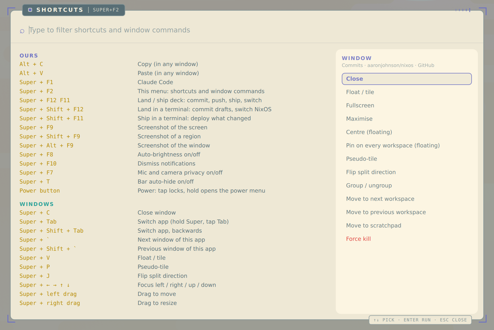

# hadron

NixOS flake for a Framework Laptop 13 Pro (Intel, Arc B390 graphics, Intel NPU):
Hyprland with a Lua config, a quickshell bar and popups, Japanese input, encrypted
hibernation, and a few local services of my own.



*Super+F2 lists every Hyprland binding that has a description, grouped by section and
read live from `hyprctl binds -j`, so it can't go stale. The right column runs window
commands on the window that had focus. Type to filter.*

## Layout

| File | What it sets up |
|---|---|
| `flake.nix` | One system, `hadron`, on `nixos-unstable`, plus the modules below |
| `configuration.nix` | Hyprland (UWSM, greetd + tuigreet), graphics and OpenVINO GPU runtime, keyboards, fcitx5 (Anthy), printing, packages |
| `hardware-configuration.nix` | LUKS → btrfs subvolumes (`@root`, `@nix`, `@home`), NPU, microcode |
| `power.nix` | Hibernation to an encrypted swap file, suspend-then-hibernate on lid close (battery), power button handed to Hyprland, `acpi=copy_dsdt` |
| `privacy.nix` | Hardware mic/camera switch state for the bar; `privacy-toggle` (Super+F7) de-authorises the webcam and mutes capture in software |
| `jantar.nix` | [jantar](https://github.com/aaronjohnson/jantar): a polar-dial dashboard on tty12 (Ctrl+Alt+F12) |
| `misra.nix` | [misra](https://github.com/aaronjohnson/misra): cross-checks power and network sensors with logic rules |
| `github-runner.nix` | Self-hosted Actions runner for [nixos-intel-npu](https://github.com/aaronjohnson/nixos-intel-npu), which builds and tests on this machine's NPU (pushes to main only, never PRs) |
| `consoles.nix` | btop / nvtop on tty11 / tty10 without a login; currently off (Hyprland lost the display returning from them) |

Flake inputs: `nixpkgs` (unstable), `nixos-intel-npu` (NPU compiler, Cachix cache),
`jantar`, `misra`, and `claude-code-flake`.

## Desktop

The Hyprland config and quickshell files live in a separate dotfiles repo
(`~/dotfiles/hypr`, `~/dotfiles/quickshell`). Popups share one frame (`SciFrame.qml`): a
reversed title tab on the top border, a hint tab on the bottom one, corner brackets, and the
Solarized palette, switching light/dark at sunrise and sunset.

| Keys | What |
|---|---|
| Super+F2 | Shortcuts and window commands (above) |
| Super+F12 / F11 | Land/ship deck: a tile per repo with chips to commit drafted messages, push, bump this flake's inputs, deploy, and switch |
| Super+Shift+F12 / F11 | The same in a terminal, one y/N question at a time |
| Super+Tab, Super+` | Mac-style app switcher; windows of the current app |
| Super+F7 / F8 / F9 / F10 | Privacy toggle / auto-brightness / screenshots / dismiss notifications |
| Power button | Tap locks; hold opens the power menu |
| Ctrl+Alt+F12, Ctrl+Alt+F1 | jantar dashboard; back to Hyprland |

Password prompts (pkexec, the switch below) come from quickshell itself acting as the polkit
agent, in the same frame, one at a time. Without quickshell, pkexec in a terminal falls back
to a text prompt.

**Keyboards.** The laptop keyboard is JIS (`jp`, `jp106`, Caps Lock as Ctrl). An external
Keychron K2 Pro gets a US layout per device in Hyprland. Its side switch stays on Mac
for the other machines it serves, so a udev hwdb rule turns its Mac media top row back into
F1–F12 here. Super sits where Cmd is, Ctrl and Alt stay with Emacs and the terminal.

## Changing the system

Commits are drafted into `.git/COMMIT_DRAFT` and landed from the deck (Super+F12) or
`land` in a terminal. Landing commits each drafted repo, pushes and bumps any flake input
that changed, builds, and offers a switch only when the result differs from the running
system:

```sh
pkexec nixos-rebuild switch --flake ~/nixos#hadron
```

To build without switching:

```sh
nix build ~/nixos#nixosConfigurations.hadron.config.system.build.toplevel
```

Secrets stay out of the repo: the runner token lives in `/var/lib/github-runner-secrets/`,
and misra's uplink names in `/var/lib/misra/local.toml`.
